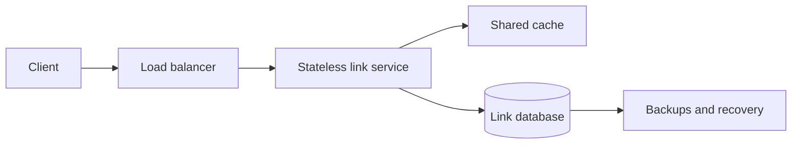

# URL shortener — worked HLD

## Requirements and assumptions

Create a short URL for an HTTP(S) destination and redirect visitors. Custom aliases, analytics and user-managed edits are initially excluded. Assume 1 million new links/day, 100 million redirects/day, 10× peak traffic and 365-day retention. Example targets: redirect p99 under 100 ms and 99.9% monthly availability; these are design assumptions, not measured guarantees.

## Capacity

- Writes: 1,000,000 / 86,400 ≈ 12 requests/s average, 120/s peak.
- Reads: 100,000,000 / 86,400 ≈ 1,158/s average, 11,580/s peak.
- At an assumed 500 bytes/record: 365 million records × 500 bytes ≈ 182.5 GB raw/year; three copies ≈ 547.5 GB before indexes, backups, logs, and overhead.
- At an assumed 500 bytes/redirect response: average egress ≈ 0.58 MB/s, peak ≈ 5.8 MB/s, excluding TLS/protocol overhead. Destination page traffic is not served by this system.

Measure URL sizes and hot-key distribution before treating these as production sizing figures.

## API and data model

- `POST /links`, authenticated, body `{destination}`, optional `Idempotency-Key`; returns 201 with `{code, shortUrl, expiresAt}`.
- `GET /{code}` returns 302 with Location for an active code, or 404 when absent/expired. A temporary redirect preserves control over future disabling; explicitly define browser/CDN cache policy.
- `links(code PRIMARY KEY, destination, created_at, expires_at, status, owner_id)`.
- `create_requests(owner_id, idempotency_key, request_hash, code)` has a unique composite key; conflicting payload reuse returns 409. Create it transactionally with the link.

Generate random 10-character base62 codes. The namespace is 62^10 ≈ 8.39×10^17. Collisions remain possible: enforce uniqueness and retry generation on conflict. Randomness does not replace authorization or abuse controls.

## Architecture

Write path: validate scheme and length, authenticate/rate-limit, generate code, atomically insert link and optional idempotency record, respond after durable commit. Read path: check cache, fetch the indexed row on a miss, validate status/expiry, populate cache, redirect. Use bounded cache TTL and briefly cache misses to limit repeated invalid-code lookups.

Start with an indexed relational store and replicas if measurements justify them. Raw data size does not alone demand sharding. If throughput or index size becomes a constraint, partition by hash(code) and examine hot-key behavior separately.

## Deep dive: consistency and hot links

A newly created link should work immediately. Initially read the primary on cache misses to avoid replica lag; later consider primary fallback for replica misses. Immutable destinations simplify caching. Expiry must be checked from cached metadata and TTL must not extend beyond expiry. Disabling abusive links requires eviction and an explicit bound on stale redirects; for strict immediate blocking, add an authoritative deny check and account for its latency/availability cost.

Hot links benefit from cache replication or edge caching, but a shared cache can itself become a hot-key bottleneck. Request coalescing prevents a stampede after expiry. Load-test realistic skew rather than uniform random traffic only.

## Failure handling and operations

| Failure | Response / tradeoff |
| --- | --- |
| Cache unavailable | Time-bound cache calls; protect database with concurrency limits and load shedding |
| Database unavailable | Serve valid cached links; fail uncached reads and writes explicitly |
| Duplicate POST retry | Return existing result for same scoped idempotency key and request hash |
| Code collision | Unique constraint; bounded retry, then controlled error |
| Overload | Rate limits and 429/503; bounded client retries with jitter |
| Data loss | Backups, point-in-time recovery, and regularly tested restore procedures |

Track redirect p50/p95/p99, error rate, cache hit ratio, DB saturation, replica lag, collision retries and abuse reports. Choose RPO/RTO explicitly; replication is not a backup. Avoid logging full private destination URLs or credentials.

## Security and alternatives

Allow only HTTP(S), validate URL length, authenticate writes, and add abuse reporting/takedown. A redirect-only service need not fetch destinations; adding previews creates a new SSRF-sensitive subsystem requiring separate controls.

Alternative: monotonically increasing IDs encoded in base62 avoid random collisions but expose enumeration and need safe ID allocation. Alternative: a key/value store aligns with code lookup but changes transaction/idempotency and operational choices. Select based on measured load and team capabilities.

## Practice follow-up

Redesign for custom aliases, mutable destinations, regional failover, or analytics. Explain what changes in the API, consistency model, and storage. This is a design exercise; no service has been deployed or benchmarked.
