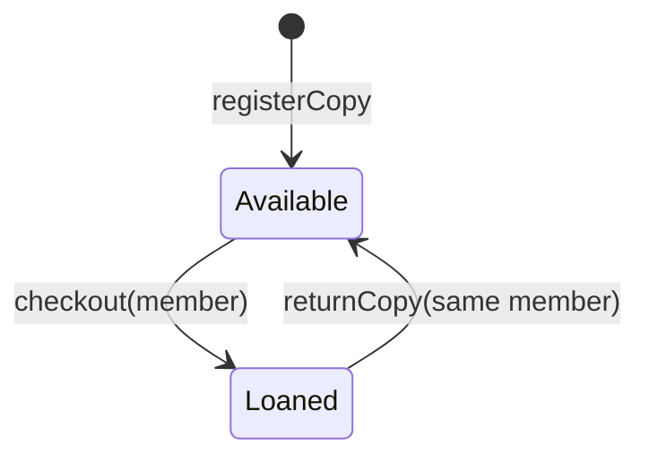

# Library loans — starter LLD

## Scope and invariant

Register a physical book copy, lend it to an identified member, and accept a return from the same member. Each copy has at most one active borrower. Copy IDs identify physical inventory, not ISBNs. Membership validation, due dates, fees, persistence and HTTP are out of scope for this starter.

## Model and API

`Library` owns a set of registered copy IDs and a map from copy ID to member ID. `registerCopy`, `checkout`, and `returnCopy` enforce transitions. `activeLoans` returns an immutable snapshot; callers cannot mutate internal state.

Blank IDs, duplicate registration and unknown copies cause IllegalArgumentException. A double checkout, return without a loan, or return by another member causes IllegalStateException. Failed operations do not alter the existing loan.

## Concurrency and costs

Synchronized public operations make each state transition atomic within this Library instance. A process-wide lock is simple for a small exercise but limits throughput; multiple service instances would need database-level atomicity/constraints. Hash lookups are expected O(1). Snapshot creation is O(number of active loans), and total storage is O(copies + loans).

[Implementation](../src/main/java/com/gyanaranjan/lld/library/Library.java) · [Tests](../src/test/java/com/gyanaranjan/lld/library/LibraryTest.java)

## Extension assignments

1. Introduce immutable Book, BookCopy and Member models when metadata is required.
2. Add a LoanPolicy abstraction for membership-dependent limits; inject it instead of branching throughout Library.
3. Add due dates with an injected Clock and tests around boundary times.
4. Introduce a repository interface when persistence becomes a requirement; keep transactions around invariant checks and writes.
5. Compare coarse locking, per-copy locking, and database conditional updates.

Do not introduce all abstractions at once. Explain the requirement that justifies each additional class.
